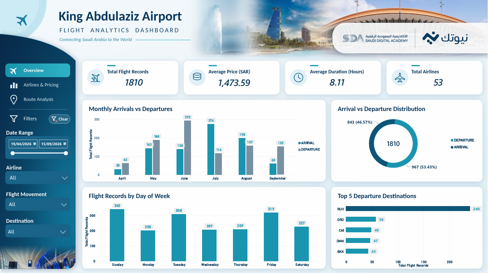
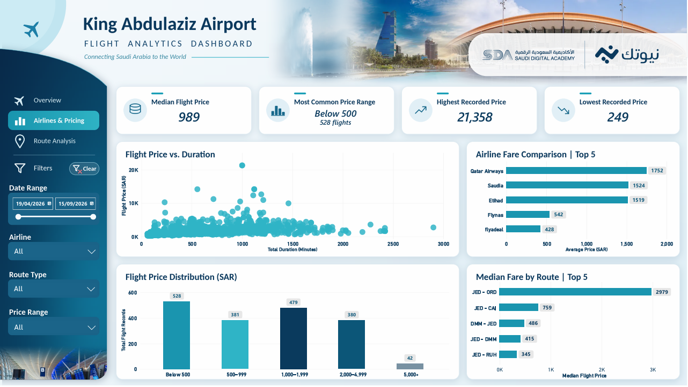
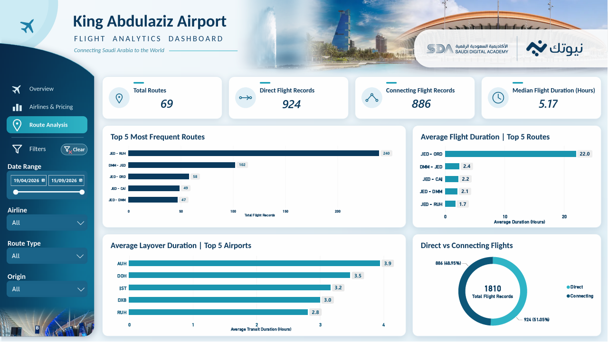

# ✈️ KAIA Flights Dashboard

An interactive flight analytics project focused on King Abdulaziz International Airport (KAIA), combining Python-based data cleaning and feature engineering with Microsoft Power BI visualization.

##  Project Overview

This project explores flight records associated with King Abdulaziz International Airport. It aims to analyze flight activity, pricing patterns, airline comparisons, and route performance through an interactive three-page Power BI dashboard.

The project was developed during a one-month training camp with **NewTech and the Saudi Digital Academy**, providing practical experience in data preparation, data analysis, and visualization.

##  Interactive Dashboard Demo

Explore the interactive dashboard and see how its visuals and filters support flight data analysis.

**[▶ Watch the Interactive Dashboard Demo](https://drive.google.com/file/d/117en3YXTDKCyRPoz_5ZgWRtk4mBqIto6/view?usp=sharing)**

##  Dashboard Preview

### 1. Flights Overview

The Overview page provides a high-level summary of flight activity through key performance indicators, including total flight records, average price, average duration, and total airlines.

It also includes visualizations for:

- Monthly arrivals and departures.
- Arrival versus departure distribution.
- Flight records by day of the week.
- Top five departure destinations.

This page helps users understand the overall distribution and patterns of flight activity.

### 2. Airlines & Pricing

The Airlines & Pricing page focuses on flight fare patterns and price comparisons across airlines and routes.

Key visualizations include:

- Median flight price.
- Most common price range.
- Highest and lowest recorded prices.
- Flight price versus duration.
- Airline fare comparison.
- Flight price distribution.
- Median fare by route.

Interactive filters allow users to explore the data by date range, airline, route type, and price range.

### 3. Route Analysis

The Route Analysis page explores route frequency, flight duration, and transit patterns.

It includes:

- Total routes.
- Direct versus connecting flight records.
- Top five most frequent routes.
- Average flight duration for selected routes.
- Average layover duration across transit airports.
- Direct versus connecting flight distribution.

These visualizations help users compare routes and explore differences between direct and connecting flights.

## 🛠️ Tools & Technologies

- **Python** — data preparation and analysis.
- **Pandas** — data inspection, cleaning, and transformation.
- **NumPy** — numerical data handling.
- **Google Colab** — notebook development and execution.
- **Microsoft Power BI** — interactive dashboard development.

## 🧹 Data Cleaning & Preparation

The data preparation workflow includes the following steps:

1. **Data Loading:** Importing the raw flight dataset into Python.
2. **Data Exploration:** Inspecting column names, data types, missing values, duplicate records, and numerical summaries.
3. **Duplicate Removal:** Removing exact duplicate rows.
4. **Transit-Duration Validation:** Identifying and flagging suspicious transit-duration records.
5. **Missing-Value Handling:** Applying documented handling rules for missing transit durations on direct flights.
6. **Feature Engineering:** Creating additional analytical fields, including `month`, `route`, `duration_hours`, and `transit_duration_suspect`.
7. **Data Validation:** Checking the resulting dataset structure and cleaning results.
8. **Data Export:** Exporting the cleaned dataset for use in Power BI.

The transit-duration rules are specific to this dataset and should not be interpreted as universal rules for all flight datasets.

## 💻 Python Notebook

The Python notebook documents the data preparation and analysis workflow, from initial inspection through cleaning, feature engineering, validation, and export.

**[Open the Google Colab Notebook](https://colab.research.google.com/drive/1gBQv0qvTAnvaic7zv68nNJPhSQC5fAGA?usp=sharing)**

##  Project Files

The GitHub repository currently includes:

- `King_Abdulaziz_Airport.pdf` — project PDF.
- `King_Abdulaziz_Airport_Analysis.ipynb` — Python notebook.
- `overview.png` — Flights Overview dashboard screenshot.
- `airlines-pricing.png` — Airlines & Pricing dashboard screenshot.
- `route-analysis.png` — Route Analysis dashboard screenshot.
- `README.md` — project documentation.

The Power BI report (`.pbix`) can be added when its final version is uploaded and permission to share it has been confirmed.

##  Training Background

This project was developed in the context of a one-month training camp with **NewTech and the Saudi Digital Academy**.

This statement describes the project's training context and does not imply official endorsement or certification by either organization.

